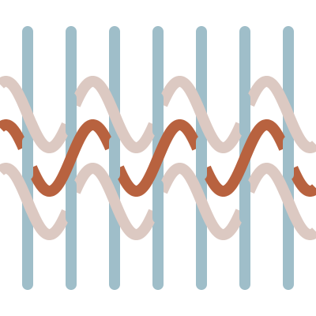
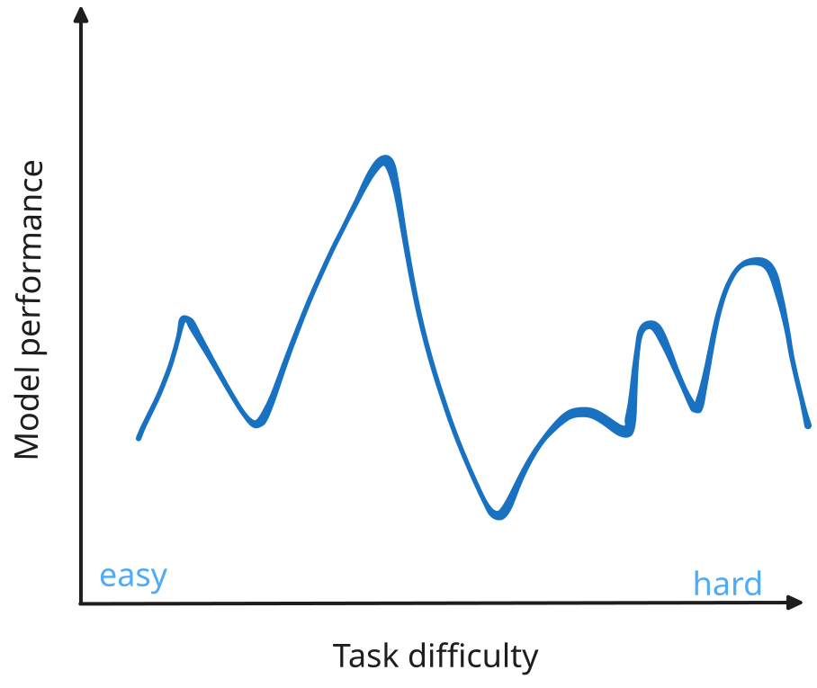
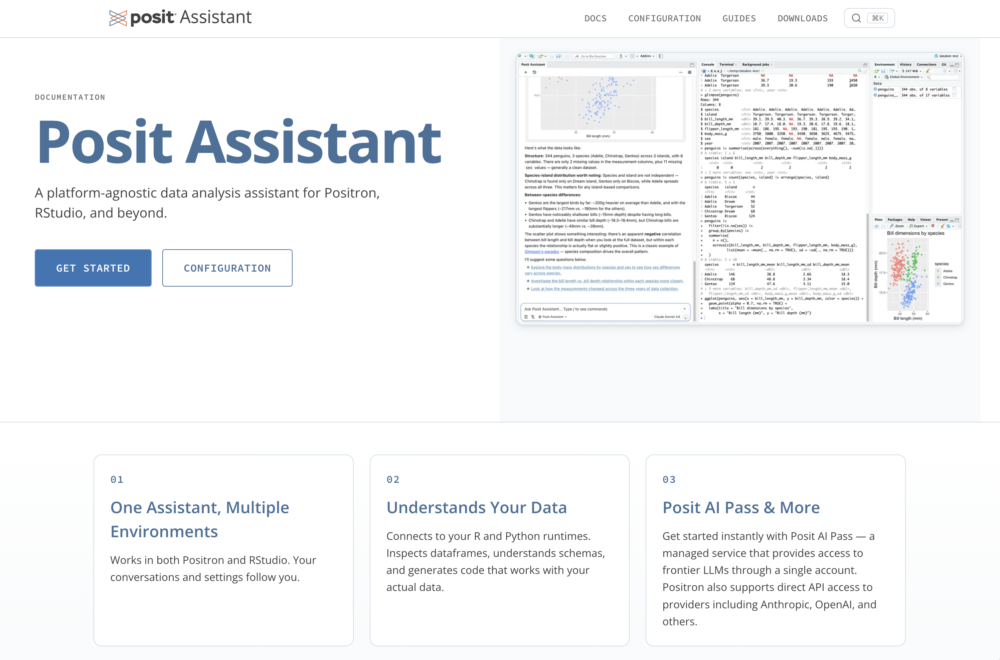
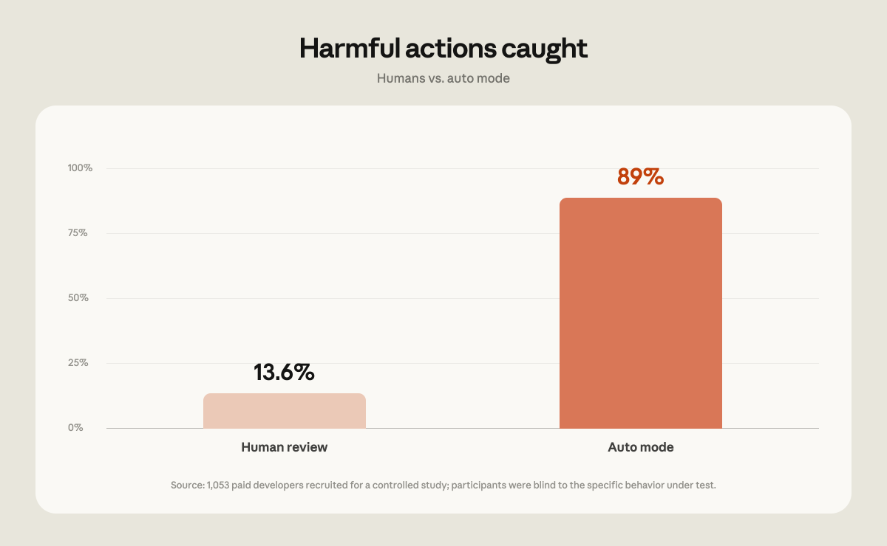
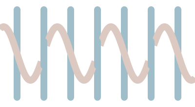

## {#title .title-slide .deep-slide}

::: {.columns}

::: {.column width="68%"}
### Weaving in trust {.talk-title}

::: {.talk-subtitle}
Data agents in 2026
:::

::: {.talk-meta}
**Sara Altman**

J&J Shiny Day · October 15, 2026
:::
:::
:::

::: {.title-weave}

:::

::: {.footer .title-footer}
https://pos.it/TODO
:::

::: notes
A year ago, we were really worried about Databot. Some of those concerns are
much less relevant now because the models have improved.

Today I want to talk about what has changed and how we weave trust into the
systems themselves so these things work for us.

Because it's Shiny Day, I'll spend some time on commons, a new open-source
package built on shinychat. First, the story of an eval.
:::

## The story of an eval {#story-of-an-eval .beat-slide}

```{r}
#| include: false
library(ggplot2)
library(dplyr)
library(forcats)
library(ggforce)
library(scales)

original_results_env <- new.env()
load("data/bluffbench-original-results.rda", envir = original_results_env)
bluffbench_original_results <- original_results_env$bluff_results

latest_results_env <- new.env()
load("data/bluffbench-latest-results.rda", envir = latest_results_env)
bluffbench_latest_results <- latest_results_env$bluff_results

bluff2_results_env <- new.env()
load("data/bluffbench2-latest-results.rda", envir = bluff2_results_env)
bluff2_latest_results <- bluff2_results_env$bluff2_results

bluffbench_results_theme <-
  theme_minimal(base_size = 22) +
  theme(
    plot.background = element_rect(fill = "#f5f0ee", color = NA),
    panel.background = element_rect(fill = "#f5f0ee", color = NA),
    legend.background = element_rect(fill = "#f5f0ee", color = NA),
    legend.key = element_rect(fill = "#f5f0ee", color = NA),
    panel.grid.minor = element_blank(),
    panel.grid.major = element_line(color = "#dedbd5"),
    text = element_text(color = "#3c4a52"),
    axis.text = element_text(color = "#3c4a52"),
    strip.background = element_blank(),
    strip.text = element_text(color = "#3c4a52", face = "bold"),
    plot.title.position = "plot"
  )

bluff2_summary <-
  bluff2_latest_results |>
  summarize(
    score = (sum(score == "C") + (sum(score == "P") * .5)) / n(),
    .by = model
  ) |>
  mutate(model = gsub(" (medium)", "", model, fixed = TRUE))
```


## {#bluffbench-counterintuitive-plot .paper-slide}

::: {.plot-slide-content .fragment data-fragment-index="0"}

```{r}
#| echo: false
#| fig-align: center
#| fig-alt: "A scatterplot of price against carat. The points form a clear negative association, with price generally falling as carat rises."
#| fig-width: 12
#| fig-height: 6
#| fig-bg: "#f5f0ee"
#| out-width: "92%"
bluffbench_diamonds <- ggplot2::diamonds |>
  mutate(carat = max(carat) - carat)

ggplot(bluffbench_diamonds, aes(x = carat, y = price)) +
  geom_point(size = 3, alpha = 0.2) +
  theme(
    plot.background = element_rect(fill = "#f5f0ee", color = NA),
    axis.title = element_text(size = 30, color = "#3c4a52"),
    axis.text = element_text(size = 22, color = "#3c4a52")
  )
```

:::

<div class="fragment fade-in-then-out plot-model-quote" data-fragment-index="1"><strong>Model:</strong> &ldquo;There&rsquo;s a strong positive relationship between carat and price!&rdquo;</div>

<div class="fragment plot-overlay-caption" data-fragment-index="2">Can models interpret plots that contradict their expectations?</div>

::: notes
around a year ago we did an experiment
we wanted to know how well models interpret plots
we showed them plots like this one, which plots diamonds and asked them to interpret them
and they said stuff like this: 
and that sounds good until you release: that is not ...

this is what we wanted to know: would models correctly interpret plots that contradicted their expectations?
:::

## November 2025 {#bluffbench-november-2025 .paper-slide}

::: {.plot-slide-content}

```{r}
#| echo: false
#| fig-align: center
#| fig-alt: "A horizontal stacked bar chart titled 'Models often report what they expect to see, not what's plotted.' GPT-5, Gemini Pro 2.5, and Claude Sonnet 4.5 are mostly incorrect."
#| fig-width: 12
#| fig-height: 7.5
#| fig-bg: "#f5f0ee"
#| out-width: "70%"
bluffbench_original_results |>
  filter(type == "mocked") |>
  mutate(score = fct_recode(score, "Correct" = "C", "Incorrect" = "I")) |>
  ggplot(aes(y = model, fill = score)) +
  geom_bar(position = "fill") +
  scale_fill_manual(
    name = NULL,
    breaks = c("Correct", "Incorrect"),
    values = c("Correct" = "#7fa8bd", "Incorrect" = "#c98a63")
  ) +
  scale_x_continuous(labels = scales::percent) +
  labs(
    title = "Models often report what they expect to see, not what's plotted",
    subtitle = "With well-known datasets",
    x = NULL,
    y = NULL
  ) +
  bluffbench_results_theme +
  theme(
    plot.title = element_text(size = 26, face = "bold"),
    plot.subtitle = element_text(size = 18),
    axis.text.x = element_text(size = 18),
    axis.text.y = element_text(size = 20),
    legend.position = "top",
    legend.justification = "left",
    legend.text = element_text(size = 18)
  )
```

:::

:::footer
posit-dev.github.io/bluffbench
:::

::: notes
We tried a range of interventions to improve these scores, but none moved them
much. 
:::

## September 2026 {#bluffbench-september-2026 .paper-slide}

::: {.plot-slide-content}

```{r}
#| echo: false
#| fig-align: center
#| fig-alt: "A faceted horizontal stacked bar chart of percent correct across recent models, split into thinking and no-thinking groups. Thinking models perform better, while most models still give many incorrect answers."
#| fig-width: 12
#| fig-height: 7.5
#| fig-bg: "#f5f0ee"
#| out-width: "70%"
bluffbench_latest_results |>
  filter(
    type == "mocked",
    release_date >= as.Date("2026-04-01")
  ) |>
  mutate(
    score = fct_recode(score, "Correct" = "C", "Incorrect" = "I"),
    pct_correct = ave(score == "Correct", model, FUN = mean),
    model = gsub(" \\((medium|non-thinking)\\)$", "", model),
    model = reorder(model, pct_correct),
    thinking = factor(
      ifelse(thinking, "Thinking", "No thinking"),
      levels = c("Thinking", "No thinking")
    )
  ) |>
  filter(thinking == "Thinking") |>
  ggplot(aes(y = model, fill = score)) +
  geom_bar(position = "fill") +
  scale_fill_manual(
    name = NULL,
    values = c("Correct" = "#7fa8bd", "Incorrect" = "#c98a63")
  ) +
  scale_x_continuous(labels = scales::percent) +
  labs(
    title = "Models got better at interpreting counterintuitive plots",
    x = "Percent correct",
    y = NULL
  ) +
  bluffbench_results_theme +
  theme(
    plot.title = element_text(size = 26, face = "bold"),
    axis.text.x = element_text(size = 18),
    axis.text.y = element_text(size = 14),
    axis.title.x = element_text(size = 22),
    strip.text = element_text(size = 22, hjust = 0),
    legend.position = "none",
    plot.margin = margin(5.5, 5.5, 15, 5.5)
  )
```

:::

:::footer
posit-dev.github.io/bluffbench
:::

::: notes
The newer models did substantially better on this eval.
This was a failure that worried us, and interventions hadn't helped much.
Model improvements changed the results, so our assessment needs to change too.
:::

## The models got better {#models-got-better .beat-slide}

## A rising tide lifts all boats {#rising-tide background-image="figures/vidar-nordli-mathisen-U45J8RWFWvA-unsplash.jpg"}

::: footer
<span style="color:#f5f1ec;">Photo: [Vidar Nordli-Mathisen](https://unsplash.com/@vidarnm), Unsplash</span>
:::

::: notes
the rising tide of model capability really floats all the boats
:::

## A rising tide lifts some of the boats {#rising-tide background-image="figures/vidar-nordli-mathisen-U45J8RWFWvA-unsplash.jpg"}

::: footer
<span style="color:#f5f1ec;">Photo: [Vidar Nordli-Mathisen](https://unsplash.com/@vidarnm), Unsplash</span>
:::

## But this doesn't mean everything is solved {#frontier-model-not-enough .beat-slide}

::: notes
Keep this a brief qualification: improvement isn't uniform across tasks.
Bluffbench2 asks whether models notice subtle data-quality issues in plots.
:::

## {#bluffbench2-data-artifact .paper-slide}

::: {.plot-slide-content}

```{r}
#| echo: false
#| fig-align: center
#| fig-alt: "A scatterplot of sleep hours against stress score with a negative trend. A subset of points falls exactly along a straight line, suggesting a data-quality artifact."
#| fig-width: 12
#| fig-height: 6
#| fig-bg: "#f5f0ee"
#| out-width: "92%"
set.seed(617)

n <- 150
n_imp <- 35
sleep_hours <- round(runif(n, 4, 10), 1)
stress_score <- round(
  pmin(pmax(95 - 7.5 * sleep_hours + rnorm(n, 0, 8), 5), 95),
  1
)

imp_sleep <- round(runif(n_imp, 4.5, 9.5), 1)
imp_stress <- round(95 - 7.5 * imp_sleep, 1)

wellbeing_data <- data.frame(
  sleep_hours = c(sleep_hours, imp_sleep),
  stress_score = c(stress_score, imp_stress)
)

ggplot(wellbeing_data, aes(x = sleep_hours, y = stress_score)) +
  geom_point(alpha = 0.8, size = 3) +
  labs(x = "sleep (hours)", y = "stress score") +
  theme(
    plot.background = element_rect(fill = "#f5f0ee", color = NA),
    axis.title = element_text(size = 30, color = "#3c4a52"),
    axis.text = element_text(size = 22, color = "#3c4a52")
  )
```

:::

:::footer
github.com/posit-dev/bluffbench2
:::

::: notes
we showed them plots that look like this
take a look at this plot. what do you notice?

one thing that flags my attention is these points through the middle of the cloud that fall exactly on a straight line. this is something i might want to dig into further and make sure nothing strange was happening in the underlying data.

we wanted to see if models would be able to pick up on this kind of subtle visual artifact
:::

## {#bluffbench2-results .paper-slide}

::: {.plot-slide-content}

```{r}
#| echo: false
#| fig-align: center
#| fig-alt: "A horizontal bar chart of bluffbench2 scores by model. Every model scores below 50 percent, showing that frontier models still struggle to notice subtle data-quality issues."
#| fig-width: 12
#| fig-height: 7
#| fig-bg: "#f5f0ee"
#| out-width: "78%"
bluff2_summary |>
  mutate(model = fct_reorder(model, score)) |>
  ggplot() +
  aes(x = score, y = model) +
  geom_col(fill = "#6e97a8") +
  scale_x_continuous(labels = label_percent(), limits = c(0, 1)) +
  labs(
    x = "Score",
    y = NULL,
    title = "Frontier models still struggle to notice subtle data quality issues"
  ) +
  bluffbench_results_theme +
  theme(
    plot.title = element_text(size = 26, face = "bold"),
    axis.text.y = element_text(size = 22),
    axis.text.x = element_text(size = 20)
  )
```

:::

:::footer
github.com/posit-dev/bluffbench2
:::

::: notes
Models have improved, but not every capability has improved equally.
Keep this a qualification rather than a second extended warning story.

This is the jaggedness of model capability: strengths in one task don't
tell us everything about performance on another.
:::

## LLMs are jagged {#llms-are-jagged .paper-slide}

{.nostretch style="max-width: 90%; max-height: 500px; display: block; margin-left: auto; margin-right: auto;" fig-alt="A schematic showing LLM performance rising and falling unevenly across tasks of increasing difficulty."}

::: notes
Copied from rstudio/llms, website/slides/slides-02.qmd.
A task that seems harder to us isn't necessarily harder for the model.
Capabilities don't follow a smooth, predictable frontier.
:::

## {#capability-profiles .paper-slide}

```{r}
#| label: setup-capability-profiles
#| include: false
source("R/capability-profiles.R")
```

::: {.r-stack}

::: {.fragment .fade-out data-fragment-index="0"}

```{r}
#| label: capability-profile-first
#| echo: false
#| dev: png
#| dev-args: {bg: transparent}
#| fig-width: 10
#| fig-height: 6
#| fig-dpi: 160
#| fig-format: png
#| fig-bg: transparent
#| fig-align: center
#| out-width: "85%"
#| fig-alt: "An illustrative five-axis capability profile: planning, writing, code review, refactor, and data analysis."
capability_profile_plot(c(0.8, 0.6, 0.5, 0.85, 0.3), title = "Model 1")
```

:::

::: {.fragment .current-visible data-fragment-index="0"}

```{r}
#| label: capability-profile-other
#| echo: false
#| dev: png
#| dev-args: {bg: transparent}
#| fig-width: 10
#| fig-height: 6
#| fig-dpi: 160
#| fig-format: png
#| fig-bg: transparent
#| fig-align: center
#| out-width: "85%"
#| fig-alt: "A different illustrative model profile on the same five capability axes."
capability_profile_plot(c(0.45, 0.85, 0.8, 0.4, 0.65), title = "Model 2")
```

:::

::: {.fragment data-fragment-index="1"}

```{r}
#| label: capability-profile-newer
#| echo: false
#| dev: png
#| dev-args: {bg: transparent}
#| fig-width: 10
#| fig-height: 6
#| fig-dpi: 160
#| fig-format: png
#| fig-bg: transparent
#| fig-align: center
#| out-width: "85%"
#| fig-alt: "An illustrative newer-release profile on the same five capability axes."
capability_profile_plot(c(0.9, 0.7, 0.75, 0.8, 0.75), title = "Model 1.1")
```

:::

:::

::: notes
We can't really make statements like ["LLMs can't do X"]{.accent} because it changes.

Some of the things we worried about a year ago are much less relevant now.
We need to update our judgments as the evidence changes.
:::

## Advice for working with LLMs {#advice-2025 .beat-slide}

- Use the best models
- Have a human review the work
- Be (a little) afraid

::: notes
6 months ago we might have said, "use the best model available"
now it's more like use the least expensive model that does a sufficient job at your task, and switch depending on the task.

We'll come back to this advice at the end of the talk.
:::

# {.paper-slide}


# {#context-outside-the-data .statement-slide .paper-slide}

::: {.statement}
Data analysis depends on [context]{.accent} that is not in the data.
:::

::: notes
Definitions, conventions, documentation, and tacit organizational knowledge
don't automatically become available to an LLM just because it is more capable.

That context might live in data dictionaries, semantic views, or in the mind
of a coworker who has been at the organization for 20 years.

Depending on your organization's setup, making that context available can be a lot of work in itself.
:::

## How do we make data agents trustworthy? {#trust-question .deep-slide}

## {#posit-assistant .paper-slide}

{.rounded .nostretch height="650"}

::: notes
Our flagship agent is Posit Assistant. Posit Assistant is a coding and data science agent. It's available in RStudio, Positron, and the terminal. When it's running inside of your IDE, it works inside of your active R and Python session. You can use whatever model from whatever provider you want with it.
:::

::: footer
assistant.posit.co
:::

## Build the environment so that it's easy to be right

::: notes

you control the harness around the model, not the model itself
build an environment that makes it as likely as possible that your agent will fall into correctness

don't control the model control the harness
:::

## The pit of success {#pit-of-success background-image="figures/pit-of-success.png"}

::: footer
<span style="color:#f5f1ec;">Photo: [Falling into the Pit of Success](https://blog.codinghorror.com/falling-into-the-pit-of-success/), Coding Horror</span>
:::

::: notes
A pit of success: design the environment so that falling into it lands you
somewhere good. The harness should make the correct path the easy path.
:::

## Code as the foundation

::: {.incremental}
* LLMs are good at writing code
* Reproducible, transparent, auditable
:::

::: notes
does the agent have to run code? no --
it could do things "in its head," but then you lose reproducibility and transparency.

llms are good at code

we've learned from years of code for analysis...

have the agent write code
:::

## Design the harness with correctness in mind

::: {.incremental}
* Prompting: prioritize correctness, not progress.
* Tools that serve correctness: run code, see your session.
* Access to your files and environment to have enough context.
:::

::: notes
Prompting: prioritize correctness over just moving the analysis forward. 
Posit Assistant ... " openness to uncertainty and subtlety, and a commitment to statistical rigor ... Rather than maintaining a feeling of "moving forward," call out ambiguities and unclear results.""
Tools: the ability to run code and see your session.
Context: give it broad access to your files and environment, so it has a good chance at knowing the correct context to solve the problem.

The harness has to work well with the person, giving them the right amount of
information at the right times.
:::

## Performance improves when the environment makes it easy to be right

::: {.fragment}

```{r}
#| echo: false
#| fig-align: center
#| fig-alt: "A grouped horizontal bar chart of percent correct per model, comparing a minimal harness against Posit Assistant. Posit Assistant scores higher for every model."
raw <- readRDS("data/bluffbench-additional-models.rds") |>
  filter(type == "intuitive") |>
  summarise(pct = mean(score == "C"), .by = model) |>
  mutate(source = "Minimal harness")

harness <- read.csv("data/harness_data.csv") |>
  filter(harness == "PositAssistant", condition == "intuitive") |>
  mutate(
    model = paste0(
      "Claude ",
      model,
      ifelse(thinking == "Medium", " (medium)", "")
    )
  ) |>
  summarise(pct = mean(correct), .by = model) |>
  mutate(source = "Posit Assistant")

bind_rows(raw, harness) |>
  filter(model %in% intersect(raw$model, harness$model)) |>
  mutate(
    model = factor(
      model,
      levels = c(
        "Claude Haiku 4.5",
        "Claude Sonnet 4.6",
        "Claude Sonnet 4.6 (medium)",
        "Claude Opus 4.8 (medium)"
      )
    ),
    source = factor(source, levels = c("Minimal harness", "Posit Assistant"))
  ) |>
  ggplot(aes(y = model, x = pct, fill = source)) +
  geom_col(position = position_dodge()) +
  scale_x_continuous(labels = scales::percent) +
  scale_fill_manual(
    values = c("Minimal harness" = "#c9d4d2", "Posit Assistant" = "#9fbec9")
  ) +
  guides(fill = guide_legend(reverse = TRUE)) +
  labs(
    y = NULL,
    x = "% correct (intuitive)",
    fill = NULL,
    title = "Performance on bluffbench eval",
    subtitle = "Posit Assistant vs. minimal harness, intuitive condition"
  ) +
  theme_minimal() +
  theme(
    legend.position = "bottom",
    axis.text = element_text(size = rel(1.5)),
    plot.title = element_text(size = rel(2)),
    plot.subtitle = element_text(size = rel(1.3)),
    legend.text = element_text(size = rel(2))
  )
```

:::

::: notes
Posit Assistant is our coding and data science agent. In the IDE it works
with your active R or Python session.
Here we compare it with a minimal harness on the intuitive condition of
bluffbench. This is a different comparison from the earlier model-update results.
Harness design can make a difference without changing the underlying model.
:::

# {#individual-oversight .beat-slide}

We can't just rely on individual oversight.

::: notes
The system has to work with how people actually behave, not depend on
individual willpower to review every action carefully.
Three examples: auto mode, showing code, and slowing down EDA.
:::

## Auto mode and human review {#auto-mode .paper-slide}

{.rounded .nostretch height="440" fig-alt="A drinking bird repeatedly presses a key on Homer's computer in The Simpsons."}

::: footer
The Simpsons GIF, via [Caps N Lock](https://www.capsnlock.com/blogs/news/simpsons-keyboard-bird)
:::

::: notes
Repeated permission prompts can turn human review into rubber-stamping.
The drinking bird is the joke: an approval click isn't necessarily review.
:::

## Auto mode and human review {#auto-mode-evidence .paper-slide}

{.nostretch height="490" fig-alt="Anthropic's chart: human review caught 13.6% of harmful actions and auto mode caught 89% in a controlled study with 1,053 paid developers."}

::: footer
[Anthropic, Auto mode is now the default in Claude Code (August 7, 2026)](https://claude.com/blog/auto-mode-default-in-claude-code)
:::

::: notes
Anthropic made auto mode the default for Pro, Max, and Team plans.
In their controlled study with 1,053 paid professional testers, human reviewers
blocked 13.6% of dangerous commands and auto mode blocked 89%.
One permission prompt per session was replaced with dangerous command text;
approving it didn't execute anything dangerous. This was a test environment,
not the testers' own projects, and isn't a claim that automation is always safer.

The point is to design review around actual human behavior, not assume that
putting a person at every approval step automatically makes a system safer.
PLACEHOLDER: Posit Assistant auto-mode comparison, if needed; not researched further.
:::

## Code visibility {#showing-all-code .paper-slide}

<video class="rounded click-to-toggle" width="100%" style="display: block; margin: 0 auto; max-height: 510px;" data-autoplay muted preload="auto" tabindex="0" aria-label="Posit Assistant recording showing expanded R code in chat, execution in the Console, and a carrier-delay plot. Click to pause or resume.">
  <source src="figures/05-pa-demo-carriers-a.mp4" type="video/mp4">
</video>

::: notes
Code should remain available for inspection, but users don't need every
execution block expanded all the time. Visibility is an interaction-design
choice, not a substitute for reproducibility.

Databot originally put executed R/Python code and output directly in chat.
Over time we added collapsible blocks and show/hide controls.
In April 2026, Hide code became independent of result visibility: users
could collapse the code input while leaving results visible.

Ordinary chat still shows data-analysis code by default. Optional hiding,
collapsed Bash calls, and Canvas summaries are distinct behaviors, not a
blanket switch to hiding R/Python code.

This recording shows expanded R code alongside its execution and plot.
It illustrates inspectability; it does not demonstrate clicking Hide code.
:::

## Slowing down the EDA process {#slowing-eda .paper-slide}

::: {.incremental}
* PLACEHOLDER: slowing down the EDA process example.
:::

::: notes
PLACEHOLDER: expand.
:::

# {#guardrails .statement-slide .paper-slide}

::: {.statement}
Guardrails, [not hope.]{.accent}
:::

::: notes
Across all four layers, build reliability and appropriate constraints into
the environment rather than relying only on individual judgment.
So far we've been talking about people doing their own analysis with an agent.
What about collaborators who are not data scientists?
:::

# But what if the user is not a data scientist? {#non-data-scientist .night-slide}

::: notes
but what if the user is not a data scientist?
how do we help them get correct answers too?
:::

## Vibe analysis {#internal-vibe-analysis .paper-slide}

Someone fires up Claude Code to answer a data question—and gets "vibe analysis" slop.

::: notes
PLACEHOLDER: add the internal example and what went wrong.
They are curious and reached for an accessible tool, but don't necessarily
have the expertise or context needed to diagnose the answer.
:::

# [_Trusted_ code]{#trusted-code style="color: #ee6331; font-size: 1.4em;"}

::: notes
This vetted code used by the data scientists is what we'll called _trusted_ code
they rely on it and trust it to give them the right answers

They also might have trusted code in

* Shiny apps
* R and Python packages
* Quarto documents

Instead of the model writing code afresh every time it's answering a question, what if it could discover and use this trusted code?

This is one of the core ideas behind a new open source package that we're excited to share with you all today. It's called commons.
:::

# {#commons .commons-intro-slide}

{.commons-intro-logo .nostretch fig-alt="Commons logo"}

:::footer
https://pos.it/commons
:::

::: notes
commons helps data scientists build trustworthy data agents for their collaborators.

It's an open source R and Python package built on `ellmer` / `chatlas` and `shinychat`. You can use it with whatever model from whatever provider you want.

and it's a bird because...
:::

## {#commons-trust-flow .trust-flow-slide .paper-slide}

<br>

```{=html}
<div class="trust-flow" role="img" aria-label="Commons searches trusted calculations, then marks answers based on whether they use a trusted calculation or a lower-trust custom path.">
  <div class="trust-tool trust-search">Search trusted calculations</div>
  <div class="trust-route-labels" aria-hidden="true">
    <span><span>Find one</span><span class="trust-decision-arrow">↓</span></span>
    <span><span>Don’t find one</span><span class="trust-decision-arrow">↓</span></span>
  </div>
  <div class="trust-branches">
    <div class="trust-branch trust-branch-high">
      <div class="trust-tool">Run trusted calculation</div>
      <span class="trust-down-arrow" aria-hidden="true">↓</span>
      <div class="trust-marker">
        
      </div>
    </div>
    <div class="trust-branch trust-branch-lower">
      <div class="trust-tool">Search context</div>
      <span class="trust-down-arrow" aria-hidden="true">↓</span>
      <div class="trust-tool">Write SQL/R/Python</div>
      <div class="trust-citation-routes" aria-hidden="true">
        <span><span>Cite</span><span class="trust-decision-arrow">↓</span></span>
        <span><span>Don’t cite</span><span class="trust-decision-arrow">↓</span></span>
      </div>
      <div class="trust-lower-outcomes">
        <div class="trust-marker">
          
        </div>
        <div class="trust-marker">
          
        </div>
      </div>
    </div>
  </div>
</div>
```

::: notes
Commons records which tools produced the answer. Trust is based on that
execution path, not on the model's confidence in its own answer. trust is deterministic

The citation itself is checked against trusted context. A custom answer is not
promoted merely because the model says it used a trusted source.
:::

## commons does 3 things

:::incremental
* Extract trusted calculations from existing artifacts into a data structure
* A harness to give the right context at the right time
* A feedback loop to push more queries up the trust ladder over time
:::

# Demos {#demos .header-slide .deep-slide}

## DevRel agent {#devrel-agent .paper-slide}

[Open the live demo](https://posit-devrel-agent.share.connect.posit.cloud/){target="_blank" rel="noopener"}

::: notes
Live demo: https://posit-devrel-agent.share.connect.posit.cloud/
PLACEHOLDER: choose questions to demonstrate.
:::

# {#clinical-trials-agent .header-slide .deep-slide}

::: {.columns}

::: {.column .header-text width="64%"}
Clinical trials agent
:::

::: {.column width="36%"}
{.header-image fig-alt="Clinical trials agent logo"}
:::

:::

::: {.footer .clinical-trials-header-footer}
[pos.it/clinical-trials-agent](https://pos.it/clinical-trials-agent)
:::

## {#clinical-trials-agent-demo}

<video class="rounded click-to-toggle" width="100%" data-autoplay muted preload="auto" tabindex="0" aria-label="Clinical Trials Agent demo. Plays automatically; click to pause or resume.">
  <source src="figures/clinical-trials-agent-demo.mp4" type="video/mp4">
</video>

::: {.footer .clinical-trials-footer}
[pos.it/clinical-trials-agent](https://pos.it/clinical-trials-agent)
:::

# {#commons-lifecycle .lifecycle-slide .paper-slide}

::: {.lifecycle-cards}
::: {.lifecycle-card .fragment .fade-up}
### Build

You construct the agent by hooking it up to trusted code.
:::

::: {.lifecycle-card .fragment .fade-up}
### Deploy

Your colleagues use the agent deployed on Connect.
:::

::: {.lifecycle-card .fragment .fade-up}
### Improve

You review the agent's behavior, adding trusted code to cover common use cases.
:::
:::

::: notes
After seeing the agents in action, what does this look like for the person
building and maintaining them?

Build: connect vetted calculations, data, and organizational context.
Deploy: make the agent available to collaborators, for example on Connect.
Improve: review its behavior and add calculations or context for recurring questions.

The boxes summarize the loops. There is no separate loops diagram.
PLACEHOLDER: expand the lifecycle examples and deployment details as needed.
:::

## Snowflake and other integrations {#integrations .paper-slide}

::: {.incremental}
* `data_source()` works with data frames, pins boards, and DBI connections
* Snowflake semantic views and Databricks metric views become trusted measures
* Answers built on them are marked trusted
:::

::: notes
PLACEHOLDER: expand on Snowflake and other integrations.
Native trusted metric execution described here is available in the R package;
do not imply feature parity with Python without checking the current implementation.
:::

## Trajectory review {#trajectory-review .paper-slide}

::: {.incremental}
* `commons(log = TRUE)` records conversation histories with OpenTelemetry
* `trajectory_read()` reads trajectories from Connect or local traces
* `trajectory_review()` opens a Shiny app to browse, flag, and annotate conversations
:::

::: notes
PLACEHOLDER: expand with specifics about hooking up the trajectory reviewer
(Connect observability settings, review markdown output, etc.).
Use reviewed conversations to find recurring questions, then add trusted
calculations or context. The goal is to improve the system, not just ask users
to check answers more carefully. These reviewer functions are in the R package.
:::

# commons, shinychat, querychat, and Posit Assistant {#ecosystem .paper-slide}

| | What it is |
|---|---|
| Posit Assistant | A coding and data science agent in RStudio, Positron, and the terminal |
| commons | An R/Python package for building trustworthy data agents with trusted calculations, context, and provenance |
| shinychat | Shiny UI components for chat interfaces |
| querychat | A chat interface for querying databases with SQL |

::: notes
PLACEHOLDER: sharpen the distinctions and the takeaway for the audience.
:::

# Revisiting the advice {#advice-2026 .paper-slide}

| Earlier advice | Now |
|---|---|
| Use the best models | Use a model appropriate for the task. Understand what different models are good at, and where they tend to go wrong. |
| Have a human review the work | Design the system to be trustworthy; don't rely on individual willpower for review. |
| Be (a little) afraid | There's plenty to do: the task now is building these systems with normal engineering, data science, and IT practices. |

::: notes
We don't want overtrust or undertrust; we want good reasons to rely on the system.
:::

# {#closing-trust .statement-slide .paper-slide}

::: {.statement}
Don't just ask people to be careful.<br><br>
[Weave trustworthiness into the system.]{.accent}
:::

::: notes
Use a model appropriate for the task and understand where it tends to go wrong.
Design a trustworthy system rather than relying on individual willpower for review.
There is plenty to build: engineering, data science, and IT practices that
make these systems useful and dependable.
We don't want overtrust or undertrust; we want good reasons to rely on the system.
:::

# {#thank-you .thank-you-slide .deep-slide}

```{=html}
<div class="thank-you-wrap">
  
  <div class="thank-you-row">
    <h1>Thank you!</h1>
  </div>
  <div class="thank-you-resources">
    <a class="thank-you-resource thank-you-link-card thank-you-slides-card" href="https://pos.it/keynote">
      <span class="thank-you-resource-label">Slides</span>
      <span class="thank-you-resource-link">pos.it/keynote</span>
    </a>
    <a class="thank-you-resource thank-you-link-card thank-you-commons-card" href="https://pos.it/commons">
      <span class="thank-you-resource-label">Commons</span>
      <span class="thank-you-resource-link">pos.it/commons</span>
    </a>
    <a class="thank-you-resource thank-you-link-card thank-you-newsletter-card" href="https://pos.it/ai-newsletter">
      <span class="thank-you-resource-label">AI Newsletter</span>
      <span class="thank-you-resource-link">pos.it/ai-newsletter</span>
    </a>
  </div>
</div>
```

::: notes
we will be in the lounge
:::
